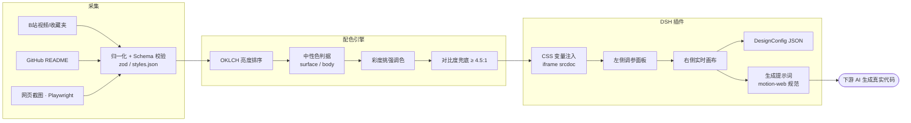

# Design Vault & DSH Workbench

**把"看到的风格"变成"可复用的设计资产"** —— 抓取、归一化、配色推导、实时预览、一键导出给 AI 的完整闭环。

<!-- 占位：切换风格 -->


---

## 它是什么

Design Vault 是一个个人前端风格库：从 B 站教程、GitHub 仓库、网页截图里抓取真实设计，抽成结构化条目（配色、字阶、组件、提示词），再用一套确定性的 OKLCH 配色引擎把它们变成可落地的设计令牌。

DSH Workbench 是它的预览与交付端：一个 DeepSeek Harness 插件。左侧调风格与维度，右侧用真实 CSS 变量渲染画布，底部一键导出 `DesignConfig` 或一份**带完整规范的生成提示词**。

两条设计原则贯穿全项目：

- **配色不靠猜** —— 任何一组 HEX 都按 OKLCH 亮度排序 + 彩度挑强调色 + 中性色派生落位，并强制通过 WCAG 4.5:1 对比度；
- **规范随资产一起走** —— 导出的 JSON 里带着 20 条动效配方、16 道去 AI 味闸门、68 条硬规范，下游 AI 无法"顺手优化"掉。

<!-- 占位：动效预览 -->


---

## 架构



---

## 快速开始

```bash
# 主应用（Next.js）
git clone https://github.com/YUME-hu/design-vault.git design-vault
cd design-vault
pnpm install
cp .env.example .env.local   # 填入自己的密钥，见下表
pnpm dev

# DSH 插件（独立仓库）
git clone https://github.com/YUME-hu/design-vault-plugin.git design-vault-plugin
cd design-vault-plugin
pnpm install
pnpm verify
```

插件装进 DSH：

```bash
dsh plugin --profile web add link:$PWD
```

### 环境变量

| 变量 | 用途 | 必填 |
|---|---|---|
| `BILIBILI_SESSDATA` | B 站收藏夹/搜索的只读 Cookie | 抓取时需要 |
| `DEEPSEEK_API_KEY` | 从视频/截图里抽取风格的模型调用 | 抓取时需要 |
| `DEEPSEEK_BASE_URL` | 自建/代理地址，留空走官方 | 否 |
| `GITHUB_TOKEN` | 提高 GitHub README 抓取的速率上限 | 否 |
| `VISION_MODEL` | 视觉抽帧用的模型 | 否 |

> 所有密钥只存在本地 `.env.local`，已被 `.gitignore` 排除，仓库内不含任何真实密钥。

<!-- 占位：一键复制 Prompt -->


---

## 目录结构

```
design-vault/
├── app/            Next.js 页面
├── components/     界面组件
├── lib/
│   ├── color.ts        OKLCH 配色引擎（纯函数）
│   ├── schema.ts       zod 数据契约
│   ├── ingest/         采集链路（B站 / GitHub / 视觉）
│   └── search/         检索
├── data/           风格库（styles.json / palettes.json / effects.json）
├── scripts/        采集与验收脚本
└── docs/           里程碑验收记录
```

`refs/`（参考站截图）、`data/pending.json`、`data/refs.json`、`data/ingest-state.json`、`data/llm-usage.log` 属于本地运行产物，已在 `.gitignore` 中排除。

---

## 配色引擎

给定一组无序的 HEX，按固定规则落位到五个语义槽，结果可复现：

1. **纸**取最亮；若最亮者彩度 > 0.12 且存在深色，判定为暗色系并翻转；
2. **强调色**取非纸色中彩度最高者；
3. **标题**取与纸对比度最高者，不足 4.5:1 就沿亮度轴推深（褪彩度保色相）；
4. **正文**取次高对比度，退化成同色时向纸轻推并复检；
5. **表面**只接受落在目标亮度 ±0.12 的中性色，否则从纸派生。

31 套精选配色（含永井博 City Pop、珠宝情绪、品牌标准色、motion-web 视觉库）全部通过这套规则生成，对比度告警仅剩 4 条——都是色板本身没有鲜艳色。

---

## DSH Workbench 插件

- 7 个维度：风格、密度、字体、聚合、圆角/阴影/边框、动效、配色来源；
- 画布是 `<iframe srcdoc>`，所以 `@keyframes`、`:hover`、`pointer` 视差都是真的；
- 导出两种产物：`DesignConfig` JSON，或一份 5.9 KB 的生成提示词。

---

## 感谢与致敬 (Acknowledgments)

本项目的**动效规范与视觉基线**直接吸收自开源技能 [**motion-web**](https://github.com/feitangyuan/motion-web)：

- `references/design-slop.md` —— 16 道去 AI 味闸门（A1–A8 / B1–B8），构成导出提示词的"静帧判据"章节；
- `references/motion-tokens.md` —— 时长阶梯、缓动字典、spring 预设、错峰模式、transform 性能预算，是 20 条动效配方的参数来源；
- `references/handfeel.md` —— 欠阻尼弹簧、速度耦合、`exp(-k·dt)` 帧率无关跟随、临界阻尼等物理定义，收录为 10 条硬规范；
- `references/page-design.md` / `components.md` —— 实测的字阶比（显示 ÷ 正文 ≈ 8×）、组件方言与状态矩阵；
- `data/visual-bank.json`（v1.1）—— 7 套配色原型、5 套字体系统、5 套布局原型，已 vendor 进 `src/shared/visual-bank.ts`。

配色引擎的 OKLCH 参数与对比度判据来自 [culori](https://github.com/Evercoder/culori)。感谢这些作者把方法论公开出来。

---

## License

[MIT](LICENSE) © 2026 梦澐子
