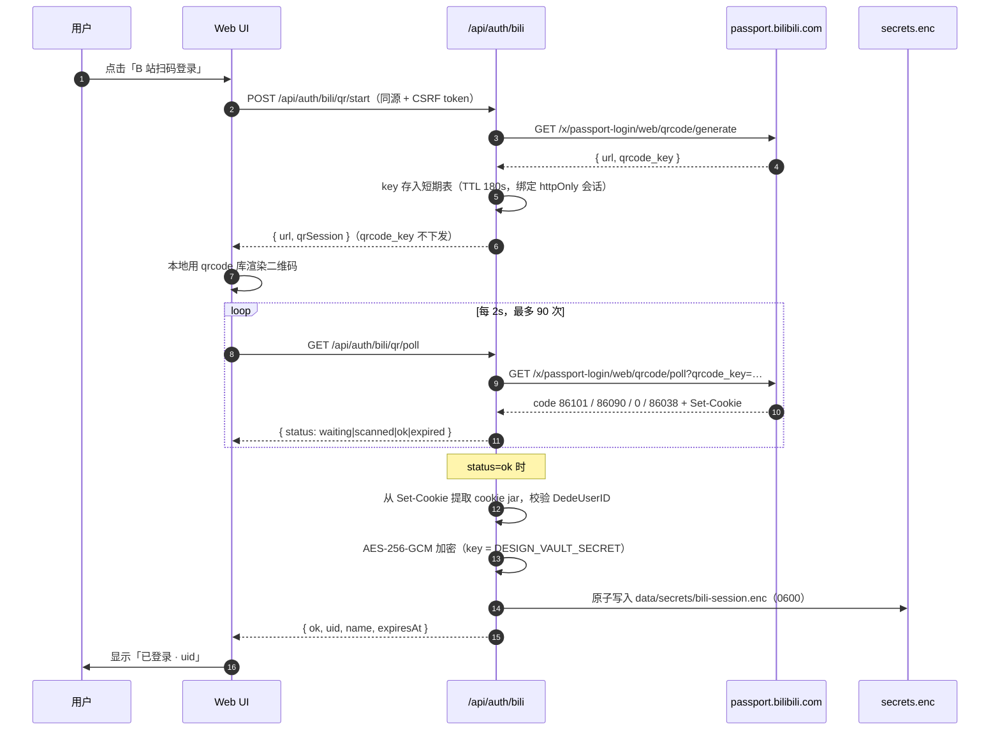
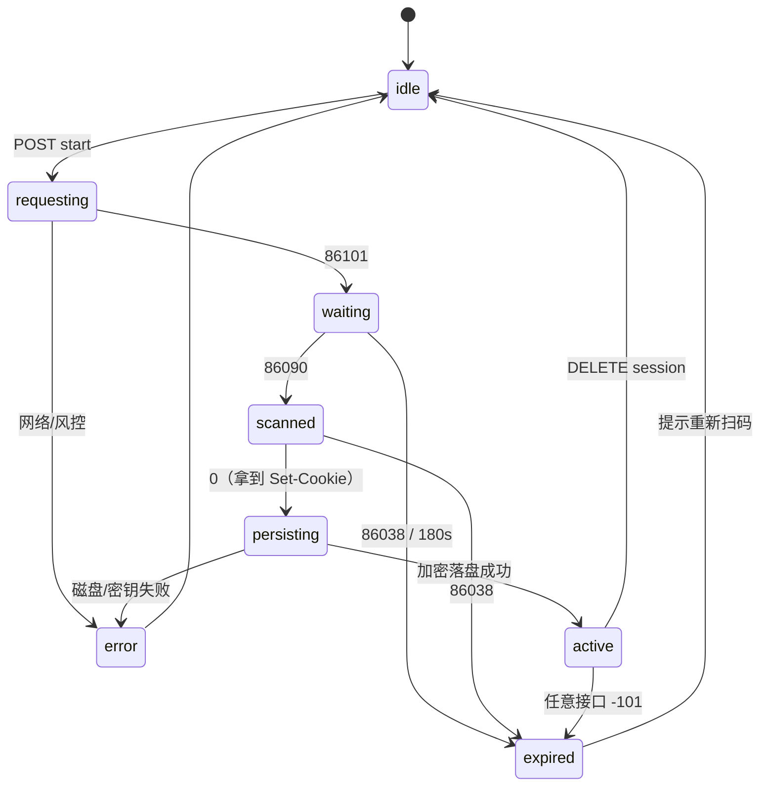

# Design Vault V2 架构设计（Monorepo + B 站扫码登录）

> 状态：**设计稿（未动代码）**。本文只回答两个问题：Monorepo 怎么切、B 站扫码登录的数据流怎么拆。
> 现有 v1.0 的 10 套 verify 是重构的护栏：每一步都必须保持全绿。

---

## 0. 白板

```
                         ┌──────────────────────────────┐
                         │        apps/web (Next.js)     │
                         │  app/ · components/ · routes  │
                         │  server-only adapters:        │
                         │  playwright capture · ffmpeg  │
                         └───────┬──────────────┬───────┘
                                 │              │
              ┌──────────────────┘              └──────────────────┐
              ▼                                                    ▼
   ┌─────────────────────┐                              ┌─────────────────────┐
   │ packages/store      │                              │ apps/dsh-plugin     │
   │ @design-vault/store │                              │ React 组件 + manifest│
   │  JSON 读写 / 加密落盘 │                              │ 只读预览 / 快捷抓取   │
   │ 注入 baseDir        │                              └──────────┬──────────┘
   └──────────┬──────────┘                                         │
              │ imports                                            │ imports
              ▼                                                    ▼
   ┌─────────────────────────────────────────────────────────────────────┐
   │                      packages/core  @design-vault/core              │
   │  纯领域：schema(zod) · color(OKLCH) · dedupe · url · recommend       │
   │  export · ingest 解析/提示词 · search 解析 · refs 令牌类型           │
   │  约束：不 import next/react/node:fs；不做网络请求；不读 process.env   │
   └─────────────────────────────────────────────────────────────────────┘
```

一句话：**core 是「规则」，store 是「落盘」，web 和插件是「壳」**。网络与浏览器能力留在壳里，用接口注入。

---

## 1. Monorepo 目录结构

### 1.1 `design-vault-core` 放哪里

**放在 `packages/core`，npm 名为 `@design-vault/core`**，不放根目录、也不塞进 `apps/`。

理由：

- 它要被 web、DSH 插件、`scripts/`（verify / 定时抓取 / 备份）三方引用，必须在 `apps/*` 之外；
- 根包 `design-vault` 只做 workspace 编排与脚本，不承载业务代码；
- 带 scope 的包名避免以后发 npm 时撞名；目录名 `core` 与包名解耦，将来可以 `@design-vault/core` 换仓库不换目录。

### 1.2 目录树

```
design-vault/
├─ package.json                 # private:true, packageManager:pnpm@9, 编排脚本
├─ pnpm-workspace.yaml
├─ pnpm-lock.yaml
├─ tsconfig.base.json
├─ apps/
│  ├─ web/                      # 现在整个 Next 应用（app/ components/ next.config）
│  │  ├─ package.json           # deps: @design-vault/core: workspace:*
│  │  └─ …
│  └─ dsh-plugin/               # DSH 客户端插件（React 组件 + manifest + 构建）
│     └─ package.json           # deps: @design-vault/core: workspace:*
├─ packages/
│  ├─ core/                     # @design-vault/core（纯逻辑，无 IO）
│  │  ├─ src/
│  │  │  ├─ schema/             # Style / Effect / Ref / Pending + zod
│  │  │  ├─ color/              # OKLCH 色阶、对比度
│  │  │  ├─ dedupe/             # 名称相似度
│  │  │  ├─ recommend/          # 规则打分
│  │  │  ├─ export/             # CSS / Tailwind / Prompt
│  │  │  ├─ ingest/             # 提示词、payload 映射、GitHub 正则、字幕解析
│  │  │  ├─ search/             # 搜索结果解析
│  │  │  └─ auth/               # 新增：B 站扫码的纯逻辑（URL 构造、状态码映射）
│  │  ├─ package.json           # exports 子路径 + tsup 构建
│  │  └─ tsup.config.ts
│  ├─ store/                    # @design-vault/store（仅 Node）
│  │  ├─ src/
│  │  │  ├─ json.ts             # readCollection / writeJsonAtomic
│  │  │  ├─ styles.ts pending.ts effects.ts refs.ts state.ts settings.ts
│  │  │  └─ secrets.ts          # AES-256-GCM 加密落盘
│  │  └─ package.json
│  └─ config/                   # @design-vault/config：tsconfig / eslint 预设（可选）
├─ scripts/                     # 仓库级脚本，从 packages/* 取逻辑
├─ data/                        # vault 数据（本地，不进 git）
├─ configs/                     # upstreams.json 等运行期配置
├─ docs/
└─ backup/ refs/ .shots/        # 产物目录
```

### 1.3 pnpm workspace 怎么引用

`pnpm-workspace.yaml`：

```yaml
packages:
  - "apps/*"
  - "packages/*"
```

根 `package.json`：

```json
{
  "name": "design-vault",
  "private": true,
  "packageManager": "pnpm@9.15.0",
  "scripts": {
    "dev": "pnpm --filter @design-vault/web dev",
    "build": "pnpm -r --filter @design-vault/core --filter @design-vault/store build && pnpm --filter @design-vault/web build",
    "verify": "pnpm --filter @design-vault/web verify",
    "typecheck": "pnpm -r typecheck"
  }
}
```

`apps/web/package.json` 与 `apps/dsh-plugin/package.json` 都用 `workspace:*` 协议：

```json
{
  "dependencies": {
    "@design-vault/core": "workspace:*",
    "@design-vault/store": "workspace:*"
  }
}
```

`packages/core/package.json` 的 exports（子路径按域拆，避免把 zod 之外的东西拖进插件）：

```json
{
  "name": "@design-vault/core",
  "type": "module",
  "exports": {
    ".":            { "types": "./dist/index.d.ts", "import": "./dist/index.js" },
    "./schema":     { "types": "./dist/schema/index.d.ts", "import": "./dist/schema/index.js" },
    "./color":      { "types": "./dist/color/index.d.ts",  "import": "./dist/color/index.js" },
    "./dedupe":     { "types": "./dist/dedupe/index.d.ts", "import": "./dist/dedupe/index.js" },
    "./ingest":     { "types": "./dist/ingest/index.d.ts", "import": "./dist/ingest/index.js" },
    "./auth":       { "types": "./dist/auth/index.d.ts",   "import": "./dist/auth/index.js" }
  },
  "scripts": { "build": "tsup", "dev": "tsup --watch", "typecheck": "tsc --noEmit" }
}
```

两个关键取舍：

1. **core 产物先 build 再被消费**（`tsup` 输出 ESM + d.ts）。web 侧加 `transpilePackages: ["@design-vault/core"]` 只在开发期图省事时用；**插件不要直接吃 TS 源码**，统一吃 dist，否则它的打包器要背 TS/装饰器配置。
2. **store 与 core 分开**：core 要能在浏览器/插件里跑，不能带 `node:fs`。store 只被 web 服务端和 scripts 引用。

### 1.4 依赖规则（可写进 CI）

| 包 | 允许依赖 | 禁止 |
| --- | --- | --- |
| `@design-vault/core` | zod、culori | next/react、node:fs、process.env、fetch |
| `@design-vault/store` | `@design-vault/core`、node:fs | next/react、网络 |
| `apps/web` | core、store、next、playwright、sharp、ffmpeg | 直接被插件 import |
| `apps/dsh-plugin` | core、（只读）store 的纯函数 | node:fs、playwright |

> 用 `eslint-plugin-boundaries` 或简单的 grep 脚本在 CI 里守这三条，比靠自觉可靠。

### 1.5 迁移顺序（每步都能回滚）

1. **抽 core**：把 `lib/schema.ts / color.ts / dedupe.ts / url.ts / recommend.ts / export.ts / ingest/{tags,palette-from-direction,pending-to-style,types,usage?}` 搬进 `packages/core`，`lib/*` 改成 re-export。跑 10 套 verify。
2. **抽 store**：`lib/data.ts / pending-store.ts / state.ts / upstreams-write.ts / refs/*` 的读写进 `packages/store`，web 侧保留薄封装。再跑 verify。
3. **apps/web 落位**：`app/ components/ next.config public/` 移入 `apps/web`，`next.config` 加 `transpilePackages` 或改成消费 dist；`scripts/` 与 `data/` 留根目录，用 `DESIGN_VAULT_HOME` 指向。
4. **插件脚手架**：`apps/dsh-plugin` 只依赖 core + 共享 UI 的**类型**，先做只读列表。
5. **V2 功能**：配置面板 `/settings`、B 站扫码登录、插件预览。

---

## 2. B 站扫码登录数据流

### 2.1 模块边界

| 层 | 位置 | 职责 |
| --- | --- | --- |
| 纯逻辑 | `core/src/auth/bili-qr.ts` | 构造 generate/poll URL、状态码 → 语义（waiting/scanned/ok/expired）、cookie 解析（从 `Set-Cookie` 取 SESSDATA/bili_jct/DedeUserID/buvid3） |
| 网络 | `apps/web/lib/auth/bili.ts`（server-only） | 调 passport 接口、超时/重试、错误归一 |
| 落盘 | `store/src/secrets.ts` | AES-256-GCM 加密文件、原子写、0600 权限 |
| 路由 | `apps/web/app/api/auth/bili/*` | start / poll / status / logout |
| 注入 | `apps/web/lib/auth/session.ts` | 统一 `getBiliCookie()`，ingest/search/capture 全走它 |
| UI | `/settings` 或顶栏 | 按钮、二维码、状态、重新登录、登出 |

### 2.2 时序



### 2.3 状态机



### 2.4 加密落盘

`data/secrets/bili-session.enc` 存信封，不存明文：

```json
{
  "v": 1,
  "alg": "aes-256-gcm",
  "iv": "base64",
  "tag": "base64",
  "ciphertext": "base64",
  "createdAt": "2026-11-04T09:00:00Z",
  "expiresAt": "2027-01-04T09:00:00Z",
  "uid": "40238601",
  "name": "路北路陈"
}
```

- key：`DESIGN_VAULT_SECRET`（32 字节 base64）。**没有 key 时拒绝落盘**（fail closed），只能走 `.env.local` 的 `BILIBILI_SESSDATA` 只读兼容路径。
- 写入：临时文件 + `rename`，Windows 上尽力 `chmod 600`（ACL 更可靠，另说）。
- 备份脚本**排除** `data/secrets/`。
- 解密结果只在内存里缓存 ≤60s，不写日志、不进错误信息。

### 2.5 注入 Cookie

```ts
// apps/web/lib/auth/session.ts（server-only）
export interface BiliSessionProvider {
  get(): Promise<{ cookie: string; buvid3?: string; source: "session" | "env" | "none" }>;
}
```

- 优先级：**加密会话 > `BILIBILI_SESSDATA` 环境变量**（保留 CI / 脚本兼容）。
- `lib/ingest/bilibili.ts` 等适配器把「读 env」改成「注入 provider」，`extractSessdata` 仍保留给脚本。
- 每次请求带 `Referer: https://www.bilibili.com/` 与 UA；`-101` 统一抛 `SessionExpiredError`，由上层清会话并提示重新扫码。
- 二维码里的 `qrcode_key` 只存在服务端短期表，前端拿不到，避免被别的客户端劫持轮询。

### 2.6 安全清单

- `qr/start`：同源校验 + CSRF + 限速（5 次/分钟）；`qr/poll`：只能轮询自己发起的会话（httpOnly 签名 cookie 绑定）。
- 响应头 `Cache-Control: no-store`；错误信息统一 `sanitizeError()` 去掉 Set-Cookie/Authorization。
- 前端不接触 SESSDATA；二维码由 URL 本地渲染，不走第三方图片服务。
- 登出即删文件 + 清缓存；会话过期保留 `lastError` 供 UI 提示，但不保留 cookie。
- 配置面板里只显示「已登录 / uid / 过期时间」，永不回显 cookie。

---

## 3. 配置面板（V2 的另一半）

- 页面：`/settings`，分组：订阅 / 抓取（延迟、超时、模型名）/ 参考库（`CAPTURE_DELAY_MS`）/ 备份 / B 站登录。
- 存储：`data/settings.json`（zod 校验、原子写），与 `data/secrets/` 分离。
- 优先级：**环境变量 > settings.json > 代码默认值**，面板上标注「已被环境变量覆盖」。
- 敏感项（密钥）只显示「已配置/未配置」，永不回显。

---

## 4. 决策记录（2026-11-04 确认）

| # | 决策 | 结论 | 影响 |
| --- | --- | --- | --- |
| D1 | 插件形态 | `apps/dsh-plugin`（DSH 客户端插件，非浏览器扩展） | 插件只读消费 core；写操作走 web API |
| D2 | 加密 key | `.env.local` 的 `DESIGN_VAULT_SECRET`（32B base64） | 无 key 时 fail closed；不引入 keytar/node-gyp |
| D3 | data/ 归属 | **web 与插件共享同一份 `data/`** | web 写、插件读；路径由 `DESIGN_VAULT_HOME` 统一注入 |
| D4 | 包管理 | 用户执行 `corepack enable` + `corepack prepare pnpm@9 --activate` | 根 `packageManager: pnpm@9`，lockfile 收敛到仓库根 |
| D5 | 插件并入方式 | **方案 A：git subtree**（保留插件提交历史，单一仓库） | `apps/dsh-plugin`；删插件内 lockfile；插件 CI 触发路径改 `apps/dsh-plugin/**` |
| D6 | Node 版本 | 插件 `engines.node` 从 `>=24` **放宽到 `>=22`**（S4 执行）；不开 `engine-strict` | 本机 22.14 直接可跑；CI 可用 node 24 跑插件、22 跑 web |

## 5. 插件并入方案（已选 A：git subtree）

现状：插件是**独立 git 仓库**（`D:\design-vault-plugin`，自身有 `.git`、`pnpm-lock.yaml`、tsdown + vitest，包名 `design-vault-plugin`，`engines.node >=24`）。

**已选：方案 A —— git subtree 并入 `apps/dsh-plugin`**

```bash
git -C D:/design-vault subtree add --prefix apps/dsh-plugin D:/design-vault-plugin main
```

- 保留插件的提交历史，同时获得 `workspace:*` 引用；
- 插件目录内的 `pnpm-lock.yaml` 删除，统一用根锁文件；
- 插件 CI（`.github/workflows`）可保留，触发路径改为 `apps/dsh-plugin/**`；
- 插件仍可独立 `npm pack`，只是源码位置变了。

**方案 B：保持独立仓库**

- 代价：`workspace:*` 跨仓库不可用，core 必须先发布（本地 tarball 或私有 registry），每次改 core 要 `pnpm pack` + 升级版本；
- 适合「插件要独立发版、给外部用」的场景。当前是自用 + 分享给朋友，**不推荐**。

**一个引擎冲突要提前处理**：插件声明 `node >= 24`，而 web 现在跑在 `node 22.14`。pnpm 默认只警告；如果开启 `engine-strict` 会直接失败。建议：

- 短期：根 `.npmrc` 不设 `engine-strict`，CI 用 node 24 跑插件、22 跑 web；
- 中期：把插件 `engines` 降到 `>=22`（如果它没用到 24 的特性）。

## 6. 执行计划与护栏

每步一个独立 commit，完成后立即跑护栏；任何一步红灯就停在那一步，不叠加改动。

| 步骤 | 内容 | 护栏 |
| --- | --- | --- |
| S1 抽 core | `lib/{schema,color,dedupe,url,recommend,export}.ts` + `ingest/{tags,palette-from-direction,pending-to-style,types}` + `search/parse`、`ingest/github` 的纯函数搬进 `packages/core`，`lib/*` 改为 re-export | `npm run verify:m0 … verify:m5`（10 套） |
| S2 抽 store | `lib/data.ts`、`pending-store`、`state`、`upstreams-write`、`refs` 读写搬进 `packages/store`，`DESIGN_VAULT_HOME` 注入，web 侧保留薄封装 | 10 套 verify + `npm run validate` |
| S3 web 落位 | `app/ components/ public/ next.config` 移入 `apps/web`；根脚本改为 `pnpm --filter` | `pnpm --filter @design-vault/web build` + 10 套 verify |
| S4 插件并入 | subtree / 独立仓库二选一；插件加 `@design-vault/core: workspace:*`，只读列表先跑通 | 插件 `pnpm verify`（oxfmt + oxlint + tsc + vitest + tsdown） |
| S5 登录链路 | `core/auth` 纯逻辑 → `/api/auth/bili/*` → `store/secrets` → `getBiliCookie()` 注入 → 设置页 UI | 新增 `verify:m6`（mock 扫码状态机 + 加密读写 + cookie 注入），并回归 10 套 |

**风险表**

| 风险 | 方案 |
| --- | --- |
| Next 消费 dist 的 HMR 变慢 | `tsup --watch` + `transpilePackages` 双轨 |
| store 抽出后路径变化 | `DESIGN_VAULT_HOME` 注入，verify 脚本不变 |
| 加密 key 丢失 | 提示重新扫码；key 不落盘、不进备份 |
| 插件 node 版本不一致 | 见 §5 引擎冲突处理 |
| pnpm 尚未安装 | 等 D4 完成后开工 |
